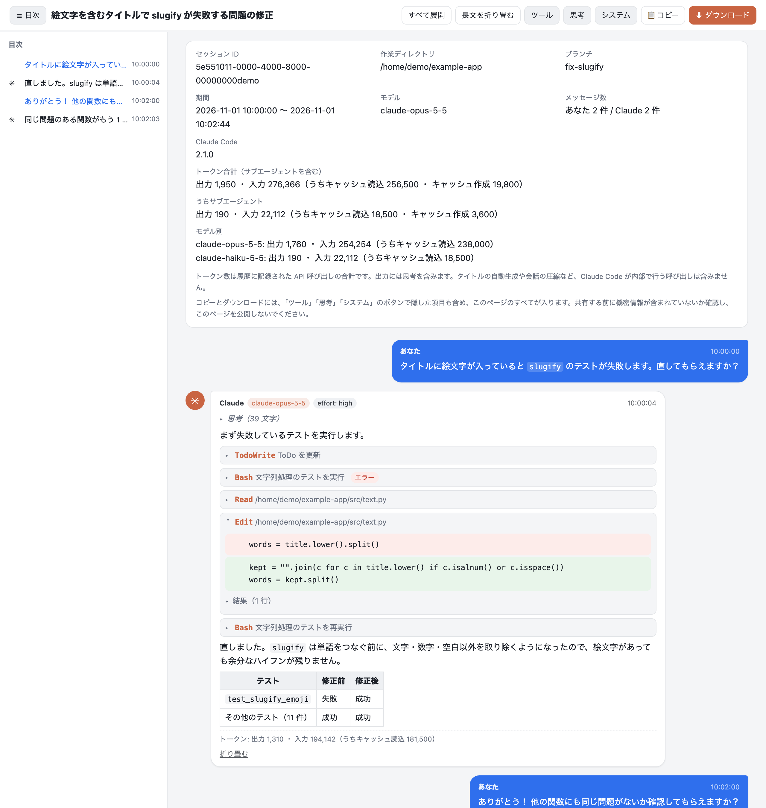
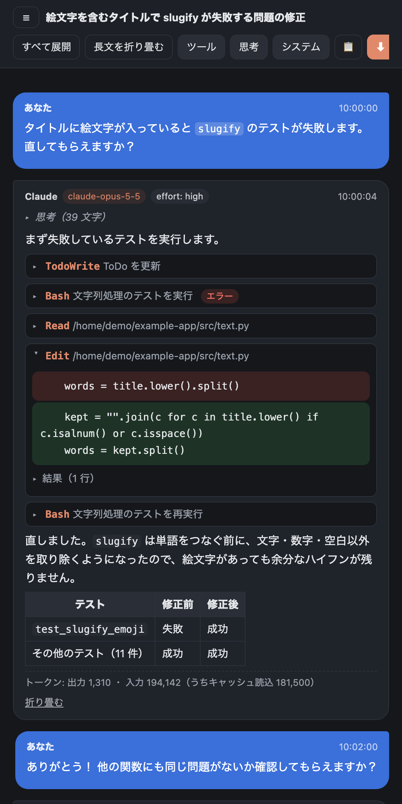

# claude-code-session-viewer

[English](README.md) | 日本語

> この文書は [README.md](README.md)（英語）の日本語訳です。内容が食い違う場合は英語版が正しい内容です。

Claude Code のセッション履歴を、メッセージアプリ風の吹き出し表示で 1 ファイルの HTML に書き出す Claude Code 用 skill。



<p align="center"></p>

画像は架空のデモセッションから作ったもの（`docs/make_screenshots.py` で生成）。

## できること

- 指定したセッションのやり取りを、時系列順に上から吹き出しで表示する
- Claude の吹き出しには、モデル（例: `claude-opus-5-5`）と effort（例: `high`）を表示する
- トークン数を、Claude の吹き出しごとと、セッション全体の合計で表示する（複数のモデルを使った場合はモデル別の内訳つき）。出力と入力を分け、入力のうちキャッシュ読み込みの分も示す。サブエージェントの分は合計に含め、内訳を別に示す。料金は表示しない
- 長いメッセージは折り畳む。折り畳んでいるときは概要（Claude は最後のテキストの冒頭と、使ったツールの集計）を表示する
- メッセージ単位の目次をサイドバーに表示する。目次の ON/OFF を切り替えられる
- ワンクリックで HTML をダウンロード、またはクリップボードにコピーできる
- ツール呼び出し、思考、システム行（コマンド実行・圧縮・モード切り替えなど）は、ページ上で表示を切り替えられる。ツール呼び出しと思考は、ファイル自体から除くこともできる（`--no-tools`、`--no-thinking`）
- サブエージェントのやり取りを、呼び出した Agent ツールの中に入れ子で表示する
- 英語と日本語で出力できる（[言語](#言語)を参照）
- ダークモードとスマホ幅に対応している

ページは 1 ファイルで完結する。外部のスクリプト・スタイル・フォント・画像は一切読み込まない（履歴内の画像は埋め込む）ので、オフラインでも開ける。

## プライバシーと共有

**生成した HTML には、セッションの内容がそのまま入る。** 会話のほかに、ツールの実行結果、Claude が読んだファイルの中身、思考、コマンドとその出力、作業ディレクトリなどのパス（通常はユーザー名を含む）が含まれる。

- **HTML を公開しないこと**（公開リポジトリ、ブログ、公開 URL など）。共有は信頼できる相手に限り、共有する前に機密情報（認証情報、顧客データ、社内 URL など）が含まれていないか確認すること。
- **「ツール」「思考」「システム」のボタンは画面上で隠すだけで、コピーとダウンロードには隠した項目も含めてすべてが入る。** ツール呼び出し（とその中のサブエージェントのやり取り）をファイルから除くには `--no-tools` を、思考（Claude とサブエージェントの分）を除くには `--no-thinking` を付けて生成する。ただし、これらで消えないものもある。ファイルに残るのは、ページ冒頭のセッション情報（タイトル、セッション ID、作業ディレクトリ、ブランチ、期間、モデル、Claude Code のバージョン、トークン数）、会話そのもの（ユーザーの発言と添付画像、添付したドキュメントのタイトル、Claude の返答）、コマンドの出力、バックグラウンドタスクの結果（バックグラウンドのサブエージェントの最終報告を含む）、フックの出力、読み込んだ Skill の内容、IDE の選択範囲、圧縮時の要約、その他のシステム行（スラッシュコマンドとその引数、編集・添付したファイルの名前、プランファイルのパス、エラーメッセージ、紐付いた PR など）。
- ファイルは本人だけが読める権限（600）で書き出す。
- 会話中のリンクはクリックでき、新しいタブで開く。その際、このページのアドレスは送らない（リファラーなし）。

## 必要なもの

- **macOS**（[対応 OS](#対応-os) を参照）
- Claude Code（CLI・VS Code 拡張機能のどちらでも使える）
- Python 3.9 以上（追加のパッケージは不要）。macOS では Xcode Command Line Tools の `python3`（3.9）や Homebrew の `python3` で動く

### 対応 OS

この skill は **macOS でのみ**開発・確認している。Linux と Windows では確認していない。分かっている問題は次のとおり。

- Windows では `python3` コマンドがない（`python` や `py` しかない）ことがあり、Python 3.15 より前では日本語のファイル名を表示するときにエラーになることがある
- OS の設定からの言語判定は macOS と Linux では動くが、Windows ではほぼ英語になる

生成した HTML は、どの OS でも最近のブラウザで見られる。

この skill は Claude Code 専用。Claude Code が保存するセッション履歴（`~/.claude/projects/`）を読むため、Cursor や Codex など他のエージェントに入れても役に立たない。

## インストール

次のいずれかの方法で、**ユーザー単位**（`~/.claude/skills/`）に入れる。ユーザー単位で入れれば、どのプロジェクトでも、CLI と VS Code 拡張機能の両方で使える。

リリースごとにタグを付けている（[Releases](https://github.com/AquaNote12/claude-code-session-viewer/releases)）。タグを指定して入れると、自分で確認したバージョンがそのまま入り、リポジトリが更新されても、自分で更新するまで入れた skill は変わらない。

### 方法 1: GitHub CLI（推奨）

GitHub CLI v2.90.0 以上が必要（`gh skill` は 2026 年 4 月に追加されたプレビュー機能）。古い場合は先に gh を更新する。

```bash
gh skill install AquaNote12/claude-code-session-viewer claude-code-session-viewer --agent claude-code --scope user
```

これで最新のリリースが入る。リリースを固定するには、skill 名の後ろに `@<タグ>` を付ける（`claude-code-session-viewer@<タグ>`。タグは Releases のページで確認する）。

`--agent claude-code --scope user` は必ず付けること。`--scope` を省くと、今いる git リポジトリの中に入る（スコープ `project`）。`--agent` を省くと、非対話の実行では GitHub Copilot 向けに入り、対話の実行ではどのエージェントにするか聞かれる。

更新:

```bash
gh skill update
```

### 方法 2: skills CLI（Node.js が必要）

```bash
npx skills add AquaNote12/claude-code-session-viewer --skill claude-code-session-viewer -a claude-code -g
```

`-g` を付けないと、今いるプロジェクトの中にだけ入る。リリースを固定するには、取得元を `AquaNote12/claude-code-session-viewer@<タグ>` にする。

更新・削除（ユーザー単位で入れた skill なので `-g` / `--global` を付ける。`update -g` はユーザー単位の skill をすべて更新する）:

```bash
npx skills update -g
npx skills remove --global claude-code-session-viewer
```

### 方法 3: 手動で配置

上の 2 つが使えない環境向け。リポジトリを clone し、skill のディレクトリを `~/.claude/skills/` にシンボリックリンクする。

```bash
git clone https://github.com/AquaNote12/claude-code-session-viewer.git
mkdir -p ~/.claude/skills
ln -s "$(pwd)/claude-code-session-viewer/skills/claude-code-session-viewer" ~/.claude/skills/claude-code-session-viewer
```

更新は clone したディレクトリで `git pull` する（リリースに固定するなら `git checkout <タグ>`）。

### インストール後

Claude Code は、開いているセッションでも新しい skill を読み込む。出てこない場合は `/reload-skills` を実行するか、新しいセッションを開く。

## 使い方

Claude Code の中で次のように呼び出す。

```
/claude-code-session-viewer                # 現在のセッションを書き出す
/claude-code-session-viewer list           # セッション一覧から選ぶ
/claude-code-session-viewer 1a2b3c4d       # ID で指定する（4 文字以上。一意に決まれば先頭の一部でよい）
/claude-code-session-viewer --lang en      # 出力の言語を指定する
```

「このセッションを HTML にして」「ツール呼び出しを除いて書き出して」のように頼んでも起動する。Claude が書き出したファイルの場所を伝え、ブラウザで開くこともできる。

スクリプトを直接実行することもできる（パスはリポジトリのルートから）。

```bash
python3 skills/claude-code-session-viewer/scripts/render_session.py list [--all] [--limit N] [--project DIR | --current-session SESSION] [--lang en|ja]
python3 skills/claude-code-session-viewer/scripts/render_session.py render <セッションID | JSONLのパス> [--out PATH] [--no-subagents] [--no-tools] [--no-thinking] [--lang en|ja]
python3 skills/claude-code-session-viewer/scripts/render_session.py open <生成した HTML のパス>
```

- **出力先**: 既定は `~/Downloads/claude-code-sessions/<タイトル>_<セッションIDの先頭8文字>_<言語>.html`。タイトルは 60 文字までに縮め、文字・数字・`_`・`-`・`.` だけを残す。`--out` には、`.html` で終わるパスなら書き出すファイルを、それ以外ならディレクトリ（なければ作る）を指定する。既存のファイルは置き換えるが、出力先のシンボリックリンクはたどらない。
- **`list`** は 1 つのプロジェクトのセッションを新しい順に表示する（既定 15 件。`--limit` で変更）。対象は `--project` で指定したプロジェクト、なければ `--current-session` で渡したセッションのプロジェクト（skill は現在のセッションを渡す）、それもなければカレントディレクトリ。そのプロジェクトにセッションがなければ、代わりに全プロジェクトを表示する。`--all` を付けると常に全プロジェクトを表示する。
- **`open`** は生成した HTML ファイルを既定のブラウザで開く（Python の `webbrowser` を使うので、シェルのコマンドは介さない）。このツールで生成したページだけを開く。

## 言語

HTML の表示（見出し・ボタン・システム行など）とスクリプトのメッセージは、英語と日本語に対応している。会話の中身は、書かれた言語のまま表示する。

言語は Claude が次のように決める（日本語なら `ja`、それ以外は `en`）。ここで「設定」とは、Claude Code に設定した応答言語、設定がなければそれまでの会話の言語を指す。

| 状況 | 言語 |
|---|---|
| 言語を明示した（`--lang en`、「英語で」、"in English" など） | その言語 |
| 依頼の言語が設定と一致する | その言語 |
| どちらか一方しかない（スラッシュコマンドだけを実行し、依頼の文がない など） | ある方の言語 |
| 両者が食い違う（ふだんは日本語で書いているが、英語で頼んだ など） | 日本語と英語のどちらにするか、Claude が聞く |
| 手がかりがない（新しいセッションでコマンドだけを実行し、言語設定もない） | OS の言語設定（`LC_ALL` / `LC_MESSAGES` / `LANG`、macOS ではシステムの言語）。それも分からなければ英語 |

非対話の実行（`claude -p` など）では質問しない。設定、それもなければ OS の言語を使う。

出力ファイル名には言語が入るので、同じセッションの日本語版と英語版を並べて残せる。

## 表示するもの・しないもの

人が読んで意味のあるものはなるべく表示し、内部向けの記録は表示しない。

| 表示する | 表示しない |
|---|---|
| ユーザーの発言（Claude の作業中に送った発言も含む）、添付画像 | API リクエストの記録、トークン残量の注記 |
| Claude のテキスト、思考（中身が記録されている場合のみ） | ツール一覧・Skill 一覧などの差分通知 |
| ツール呼び出しと結果（Bash のコマンド、Edit の差分、ToDo など） | 環境情報・日付・言語設定などの自動付与情報 |
| サブエージェントのやり取り（入れ子は 2 段まで） | ファイル履歴のスナップショット |
| Skill の読み込み、失敗したフック・標準エラー出力のあるフック | ローカルコマンドの注意書き、画像パスの注記 |
| スラッシュコマンドとその出力、バックグラウンドタスクの通知 | 中身が空の思考ブロック（暗号化された思考） |
| 会話の圧縮と要約、プランモード・オートモードの切り替え、PR との紐付け | |
| IDE で開いていたファイル・選択範囲、ユーザーが添付・編集したファイル | |
| API エラー、ユーザーによる中断、Claude Code からのお知らせ | |

## 注意点

- セッション履歴の JSONL は Claude Code の内部形式で、公式には文書化されていない。Claude Code のバージョンアップで形式が変わると、表示が崩れる可能性がある。知らない種類のレコードは読み飛ばし、表示できないレコードは、ページ全体を止めずにその部分だけ警告に置き換える。
- 既定では、Claude Code は古いセッションファイルを一定期間（`cleanupPeriodDays`。既定は 30 日）で自動削除する。
- 生のテキストのブロック（ツールの入力と結果、コマンドの出力、書き込んだファイルの中身）は、1 ブロックあたり 30,000 文字で切り詰める。発言と思考は切り詰めない。
- 画像は HTML に埋め込む（PNG・JPEG・GIF・WebP のみ）ので、画像の多いセッションはファイルが大きくなる。URL で参照されていた画像は読み込まない。
- `file://` で開いたページではブラウザによってクリップボード API が使えない。その場合は `document.execCommand("copy")` で代わりにコピーする。

## 開発

```
claude-code-session-viewer/
├── skills/
│   └── claude-code-session-viewer/      # skill 本体（この単位でインストールされる）
│       ├── SKILL.md
│       └── scripts/
│           ├── render_session.py        # 入口。CLI と言語の決定
│           └── ccsv/
│               ├── __init__.py          # モジュールの概要
│               ├── i18n.py              # 現在の言語、文言の取得、OS の言語の判定
│               ├── messages/            # 画面に出る文言。言語ごとに 1 ファイル（en.py が正本）
│               ├── util.py              # 共通の小さな関数
│               ├── markdown.py          # 最小限の Markdown → HTML 変換
│               ├── transcript.py        # セッションの探索と履歴の解析（Claude Code の JSONL 形式）
│               ├── render.py            # HTML ページの組み立て
│               └── assets/              # page.html・style.css・app.js（生成する HTML に埋め込む）
├── tests/
│   ├── test_render_session.py
│   └── fixtures/                        # テスト用の架空のセッション
├── docs/
│   ├── make_screenshots.py              # 架空のデモセッションから docs/images/ を作り直す
│   └── images/                          # この README で使っている画像
├── LICENSE
├── README.md
├── README.ja.md
└── .gitignore
```

skill のディレクトリの中身（`SKILL.md` と `scripts/`）は Agent Skills 仕様に従っている。それを `skills/` の下に置くのは、`gh skill install` と `npx skills add` が探す慣例の配置。

テストはリポジトリのルートで実行する。

```bash
python3 -m unittest discover -s tests
```

変更する場所（パスはリポジトリのルートから）:

- **文言**: `skills/claude-code-session-viewer/scripts/ccsv/messages/en.py`（正本。表示される場所ごとにまとめ、説明が必要なキーにはコメントを付けてある）と、`skills/claude-code-session-viewer/scripts/ccsv/messages/ja.py` の同じキー。全言語でキーとプレースホルダが一致しているか、英語のページに日本語が残っていないかをテストで確認している。
- **言語の追加**: `en.py` と同じ場所にファイルを足し、`skills/claude-code-session-viewer/scripts/ccsv/messages/__init__.py` に登録する。あわせて、`skills/claude-code-session-viewer/scripts/ccsv/i18n.py` の OS の言語の判定と、`skills/claude-code-session-viewer/SKILL.md` の言語の決め方も直す（今は日本語と英語だけを前提にしている）。
- **Claude Code の更新で履歴の形式が変わった**: レコードを読むのは `skills/claude-code-session-viewer/scripts/ccsv/transcript.py`。ツールごとの入力と結果の見せ方（`command` や `old_string` などのフィールド名）は `skills/claude-code-session-viewer/scripts/ccsv/render.py`。
- **画像**: ページの見た目を変えたら、`python3 docs/make_screenshots.py`（macOS と Google Chrome が必要）で `docs/images/` を作り直す。
- **ページの見た目と動き**: `skills/claude-code-session-viewer/scripts/ccsv/assets/`（`page.html`・`style.css`・`app.js`）。普通の HTML・CSS・JavaScript として編集できる。`app.js` は必要な値をページ内の JSON から読む。置換用の書式（`{{...}}`）は `page.html` の中でだけ使える。ページの Content-Security-Policy は `app.js` そのもの（生成時にハッシュを計算する）だけに実行を許可するので、インラインのイベントハンドラーや追加のスクリプトは動かない。

## ライセンス

[MIT License](LICENSE)
