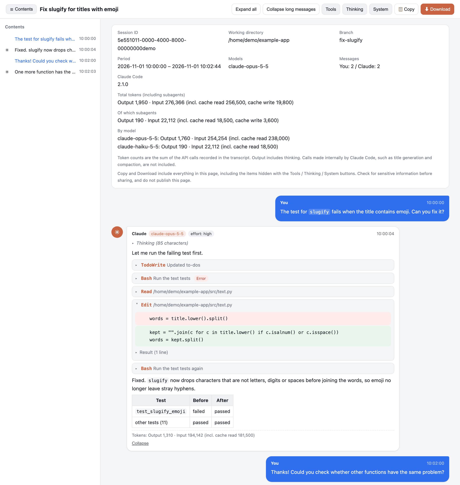
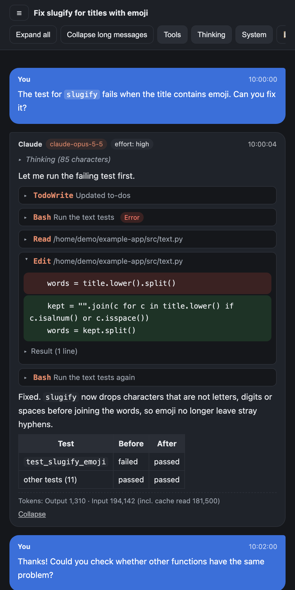

# claude-code-session-viewer

English | [日本語](README.ja.md)

A Claude Code skill that exports a session transcript to a single standalone HTML page that looks like a chat app.



<p align="center"></p>

The screenshots show a made-up demo session (generated by `docs/make_screenshots.py`).

## Features

- Shows the conversation of a session in chronological order, as chat bubbles.
- Claude's bubbles show the model (e.g. `claude-opus-5-5`) and the effort (e.g. `high`).
- Shows token usage for each Claude bubble and for the whole session (with a per-model breakdown when more than one model was used). Output and input are shown separately, and the cache-read part of the input is shown as well. Subagent usage is included in the totals and also shown on its own. Costs are not shown.
- Long messages are collapsed. A collapsed message shows a summary (for Claude: the beginning of its last text and the tools it used).
- A table of contents with one entry per message is shown in a sidebar, and can be turned on and off.
- One click downloads the HTML or copies it to the clipboard.
- Tool calls, thinking and system rows (commands, compaction, mode changes, ...) can be shown or hidden on the page. Tool calls and thinking can also be left out of the file entirely (`--no-tools`, `--no-thinking`).
- Subagent conversations are shown nested inside the Agent tool call that started them.
- The page can be generated in English or Japanese (see [Language](#language)).
- Supports dark mode and phone-sized screens.

The page is a single file. It loads nothing from the network: no external scripts, styles, fonts or images (images in the transcript are embedded), so it also works offline.

## Privacy and sharing

**The generated HTML contains your session as it is.** Besides the conversation, it includes tool results, the contents of files Claude read, thinking, commands and their output, and paths such as the working directory (which usually contains your user name).

- **Do not publish the HTML** (public repositories, blogs, public URLs, ...). Share it only with people you trust, and check it for sensitive information (credentials, customer data, internal URLs, ...) before you do.
- The **Tools / Thinking / System buttons only hide items on screen. Copy and Download include everything**, hidden items too. To leave tool calls (and the subagent conversations inside them) out of the file, generate it with `--no-tools`; to leave out thinking (Claude's and its subagents'), use `--no-thinking`. These options do not remove everything: the conversation itself, command output, hook output, IDE selections and compaction summaries stay in the file.
- The file is written readable by you only (mode 600).
- Links in the conversation stay clickable and open in a new tab without sending this page's address (no referrer).

## Requirements

- **macOS** (see [Supported platforms](#supported-platforms))
- Claude Code (works in both the CLI and the VS Code extension)
- Python 3.9 or later, with no extra packages. On macOS, the `python3` of the Xcode Command Line Tools (3.9) or of Homebrew is fine.

### Supported platforms

This skill is developed and tested on **macOS only**. Linux and Windows have not been tested. Known gaps:

- On Windows, the `python3` command may not exist (only `python` or `py`), and printing Japanese file names may fail with Python versions older than 3.15.
- Detecting the language from the OS works on macOS and Linux, but usually falls back to English on Windows.

The generated HTML page works in any modern browser on any OS.

This skill only works with Claude Code. It reads the session transcripts that Claude Code stores (`~/.claude/projects/`), so it is of no use when installed for other agents such as Cursor or Codex.

## Installation

Install it **for your user** (`~/.claude/skills/`) with one of the methods below. A user-level install works in every project, in both the CLI and the VS Code extension.

Each release is tagged ([Releases](https://github.com/AquaNote12/claude-code-session-viewer/releases)). Pinning a tag means you get exactly the version you reviewed, and an update of the repository does not change your installed skill until you choose to update.

### Option 1: GitHub CLI (recommended)

Requires GitHub CLI v2.90.0 or later (`gh skill` is a preview feature added in April 2026). Update gh first if it is older.

```bash
gh skill install AquaNote12/claude-code-session-viewer claude-code-session-viewer --agent claude-code --scope user
```

This installs the latest release. To pin a release, append `@<tag>` to the skill name (`claude-code-session-viewer@<tag>`, with a tag from the Releases page).

Always pass `--agent claude-code --scope user`. Without `--scope`, the skill is installed into the git repository you are in (scope `project`). Without `--agent`, a non-interactive run installs it for GitHub Copilot, and an interactive run asks which agent to use.

Update:

```bash
gh skill update
```

### Option 2: skills CLI (requires Node.js)

```bash
npx skills add AquaNote12/claude-code-session-viewer --skill claude-code-session-viewer -a claude-code -g
```

Without `-g`, the skill is installed only in the current project. To pin a release, use `AquaNote12/claude-code-session-viewer@<tag>` as the source.

Update and remove (with `-g` / `--global` for the user-level install; `update -g` updates all your user-level skills):

```bash
npx skills update -g
npx skills remove --global claude-code-session-viewer
```

### Option 3: Manual

For environments where neither of the above is available. Clone the repository and symlink the skill directory into `~/.claude/skills/`.

```bash
git clone https://github.com/AquaNote12/claude-code-session-viewer.git
mkdir -p ~/.claude/skills
ln -s "$(pwd)/claude-code-session-viewer/skills/claude-code-session-viewer" ~/.claude/skills/claude-code-session-viewer
```

To update, run `git pull` in the cloned directory (or `git checkout <tag>` to pin a release).

### After installing

Claude Code picks up new skills in running sessions too. If the skill does not show up, run `/reload-skills` or start a new session.

## Usage

Run it inside Claude Code:

```
/claude-code-session-viewer                # export the current session
/claude-code-session-viewer list           # pick from a list of sessions
/claude-code-session-viewer 1a2b3c4d       # by session ID (at least 4 characters; a unique prefix is enough)
/claude-code-session-viewer --lang en      # choose the language of the page
```

Asking in plain words, such as "export this session as HTML" or "export it without the tool calls", also works. Claude tells you where the file was written and can open it in your browser.

You can also run the script directly (paths are relative to the repository root):

```bash
python3 skills/claude-code-session-viewer/scripts/render_session.py list [--all] [--limit N] [--project DIR | --current-session SESSION] [--lang en|ja]
python3 skills/claude-code-session-viewer/scripts/render_session.py render <session ID | path to JSONL> [--out PATH] [--no-subagents] [--no-tools] [--no-thinking] [--lang en|ja]
python3 skills/claude-code-session-viewer/scripts/render_session.py open <path to the generated HTML>
```

- **Output**: by default `~/Downloads/claude-code-sessions/<title>_<first 8 characters of the session ID>_<lang>.html`. The title is shortened to 60 characters, and only letters, digits, `_`, `-` and `.` are kept. With `--out`, a path ending in `.html` is the file to write; any other path is a directory to write into (created if missing). An existing file is replaced, but a symbolic link at the destination is not followed.
- **`list`** shows the sessions of one project, newest first (15 by default; change with `--limit`): the project given with `--project`, otherwise the project of the session given with `--current-session` (the skill passes the current session), otherwise the current directory. If that project has no sessions, all projects are listed instead. `--all` always lists all projects.
- **`open`** opens a generated HTML file in the default browser (it uses Python's `webbrowser`, so no shell command is involved). It only opens pages generated by this version of the tool and not changed since, so that the page can run nothing but the tool's own script.

## Language

The page (labels, buttons, system rows) and the script's messages are available in English and Japanese. The conversation itself is shown in whatever language it was written in.

Claude chooses the language as follows (Japanese gives `ja`; any other language gives `en`). Here, "your setting" means the response language configured in Claude Code or, without one, the language of the conversation so far.

| Situation | Language |
|---|---|
| You name a language (`--lang en`, "in English", 「日本語で」, ...) | That language |
| The language of your request matches your setting | That language |
| Only one of them exists (e.g. you ran only the slash command, with no words of your own) | That one |
| They differ (e.g. you usually write Japanese but asked in English) | Claude asks you to choose between Japanese and English |
| There is nothing to go on (a new session with only the command, and no language setting) | The OS language (`LC_ALL` / `LC_MESSAGES` / `LANG`, or the system language on macOS), otherwise English |

In non-interactive runs (such as `claude -p`) Claude never asks; it uses your setting, then the OS language.

The language is part of the output file name, so the Japanese and English pages of a session can sit side by side.

## What is shown

Most things that mean something to a human reader are shown; internal bookkeeping is not.

| Shown | Not shown |
|---|---|
| User messages (including messages sent while Claude was working) and attached images | API request records, remaining-token notes |
| Claude's text, and thinking (only when its content was recorded) | Notifications about changes to the tool or skill lists |
| Tool calls and results (Bash commands, Edit diffs, to-do lists, ...) | Automatically added context such as environment info, date and language settings |
| Subagent conversations (nested up to two levels) | File history snapshots |
| Skills being loaded; hooks that failed or wrote to stderr | Caveats about local commands, image path notes |
| Slash commands and their output, background task notifications | Empty (encrypted) thinking blocks |
| Compaction and its summary, plan mode and auto mode changes, linked pull requests | |
| Files open and lines selected in the IDE, files attached or edited by the user | |
| API errors, interruptions, and notices from Claude Code | |

## Caveats

- The JSONL transcript format is internal to Claude Code and not officially documented. A Claude Code update that changes the format may break the page. Unknown record types are skipped, and a record that cannot be displayed is replaced by a warning instead of breaking the page.
- By default, Claude Code deletes old session files after a while (`cleanupPeriodDays`, 30 days by default).
- Raw text blocks (tool inputs and results, command output, written file contents) are truncated to 30,000 characters each. Messages and thinking are not truncated.
- Images are embedded in the HTML (PNG, JPEG, GIF and WebP only), so sessions with many images produce large files. Images that were referenced by URL are not loaded.
- On pages opened via `file://`, some browsers do not allow the Clipboard API. The copy button then falls back to `document.execCommand("copy")`.

## Development

```
claude-code-session-viewer/
├── skills/
│   └── claude-code-session-viewer/      # the skill itself (this directory is what gets installed)
│       ├── SKILL.md
│       └── scripts/
│           ├── render_session.py        # entry point: command line and language choice
│           └── ccsv/
│               ├── __init__.py          # overview of the modules
│               ├── i18n.py              # current language, message lookup, OS language detection
│               ├── messages/            # user-visible strings, one file per language (en.py is the source)
│               ├── util.py              # small shared helpers
│               ├── markdown.py          # minimal Markdown-to-HTML converter
│               ├── transcript.py        # finding sessions and parsing transcripts (Claude Code's JSONL format)
│               ├── render.py            # building the HTML page
│               └── assets/              # page.html, style.css, app.js (inlined into every page)
├── tests/
│   ├── test_render_session.py
│   └── fixtures/                        # a made-up session used by the tests
├── docs/
│   ├── make_screenshots.py              # regenerates docs/images/ from a made-up demo session
│   └── images/                          # screenshots used in this README
├── LICENSE
├── README.md
├── README.ja.md
└── .gitignore
```

The skill directory itself follows the Agent Skills specification (`SKILL.md` and `scripts/`). Placing it under `skills/` is the convention that `gh skill install` and `npx skills add` look for.

Run the tests from the repository root:

```bash
python3 -m unittest discover -s tests
```

Where to make a change (paths from the repository root):

- **Wording**: `skills/claude-code-session-viewer/scripts/ccsv/messages/en.py` (the source; grouped by where the text appears, with comments on the keys that need explaining) and the same key in `skills/claude-code-session-viewer/scripts/ccsv/messages/ja.py`. The tests check that every language has the same keys and placeholders, and that the English page contains no Japanese.
- **Adding a language**: add a file next to `en.py` and register it in `skills/claude-code-session-viewer/scripts/ccsv/messages/__init__.py`. Also extend the OS language detection in `skills/claude-code-session-viewer/scripts/ccsv/i18n.py` and the language rules in `skills/claude-code-session-viewer/SKILL.md`, which currently know only Japanese and English.
- **A Claude Code update changed the transcript format**: `skills/claude-code-session-viewer/scripts/ccsv/transcript.py` reads the records. How each tool's input and result are shown (field names such as `command` or `old_string`) is in `skills/claude-code-session-viewer/scripts/ccsv/render.py`.
- **Screenshots**: after changing the look of the page, run `python3 docs/make_screenshots.py` (macOS with Google Chrome) to regenerate `docs/images/`.
- **Look and behaviour of the page**: `skills/claude-code-session-viewer/scripts/ccsv/assets/` (`page.html`, `style.css`, `app.js`). They are plain HTML, CSS and JavaScript; `app.js` reads the values it needs from the JSON block in the page. Placeholders (`{{...}}`) are only allowed in `page.html`. The page's Content-Security-Policy allows only the exact `app.js` (its hash is computed when the page is generated), so inline event handlers or extra scripts will not run.

## License

[MIT License](LICENSE)
